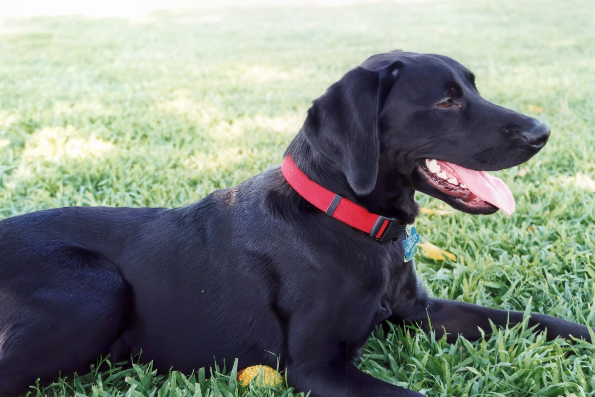
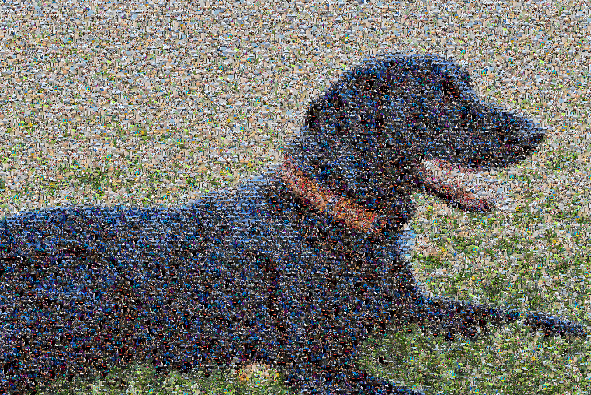

# Description

Photo mosaic tool which will use an image corpus to create the mosaic tiles.  A picture is worth a thousand words so check out Linus the dog as an example.  Click on and zoom in on the photos to see the mosaic tiles, they are scaled up 2x 5076 x 3392.  These were generated with :
```
# for the blockier tiles:
 python3 ./create_mosaic.py -s example.jpg -c ./corpus --shape hex -o example_big.png --tile-size 70 --min-distance 7 --scale 2

# for the finer tiles:
 python3 ./create_mosaic.py -s example.jpg -c ./corpus --shape hex -o example.png --tile-size 40 --min-distance 7 --scale 2

 ```

| Original | Big Tiles | Smaller Tiles |
| ---------- | ---------- | ---------- | 
|  |  |  | 


## Usage

```
usage: create_mosaic.py [-h] -s SOURCE [-c CORPUS] [-o OUT] [--shape {hex,square}] [--orientation {pointy,flat}] [--cols COLS | --tile-size TILE_SIZE] [--rows ROWS] [--scale SCALE |
                        --width WIDTH] [--matcher {random,greedy}] [--min-distance N] [--tolerance DE] [--reuse-penalty DE] [--candidates CANDIDATES] [--blend BLEND] [--grout GROUT]
                        [--grout-color GROUT_COLOR] [--max-pool MAX_POOL] [--seed SEED] [--workers WORKERS] [--cache-dir CACHE_DIR] [--no-cache]

Build a photomosaic from a source image and a corpus of photos.

options:
  -h, --help            show this help message and exit

input / output:
  -s, --source SOURCE   source image to reproduce
  -c, --corpus CORPUS   directory of tile images (searched recursively) (default: corpus)
  -o, --out OUT         output image (PNG recommended) (default: mosaic.png)

tiles:
  --shape {hex,square}
  --orientation {pointy,flat}
                        hex orientation: 'pointy' = vertex on top, 'flat' = edge on top (default: pointy)
  --cols COLS           number of tiles across (default: 100)
  --tile-size TILE_SIZE
                        tile width in output pixels (overrides --cols) (default: None)
  --rows ROWS           square shape only: fixed number of rows (cells become rectangles) (default: None)

output size:
  --scale SCALE         output size relative to the source image (default: 1.0)
  --width WIDTH         output width in pixels (height keeps aspect) (default: None)

matching / appearance:
  --matcher {random,greedy}
                        'random': shuffled visit order + random choice among near-equal colours (avoids repeating patterns in uniform areas); 'greedy': reading order, always the closest
                        colour (default: random)
  --min-distance N      two uses of the same image are at least N cells apart (0 or 1 = no limit) (default: 4)
  --tolerance DE        random matcher: candidates within this CIELAB delta-E of the best match count as equally good (~2.3 is just noticeable) (default: 6.0)
  --reuse-penalty DE    delta-E added to an image's cost per prior use; spreads usage across the pool (default: 0.0)
  --candidates CANDIDATES
                        best colour matches considered per cell (default: 100)
  --blend BLEND         0..1: shift each tile's colour toward the source colour (default: 0.0)
  --grout GROUT         width in px of lines drawn between tiles (default: 0.0)
  --grout-color GROUT_COLOR
                        grout / background colour (default: #000000)

pool / performance:
  --max-pool MAX_POOL   use a random subset of N corpus images (default: None)
  --seed SEED           seed for --max-pool subsetting and the random matcher (default: 42)
  --workers WORKERS
  --cache-dir CACHE_DIR
                        where to cache corpus colour features (default: .mosaic_cache)
  --no-cache
  ```
